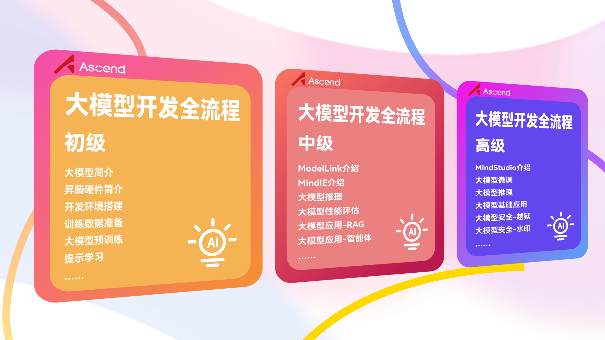
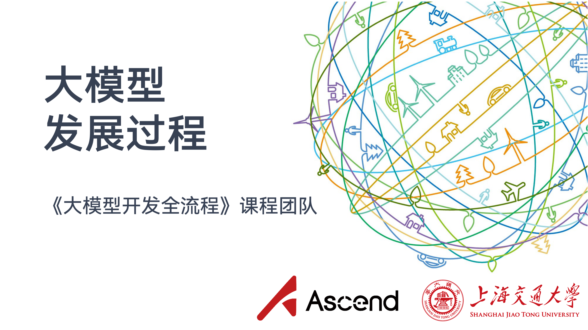
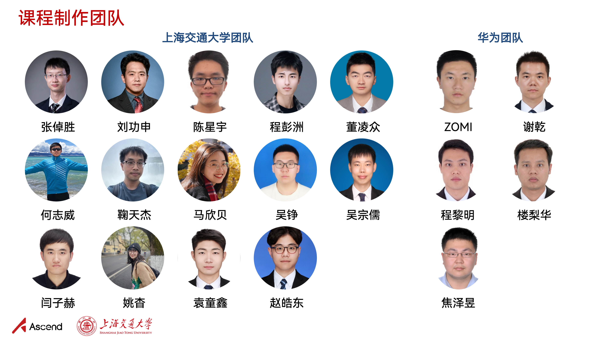
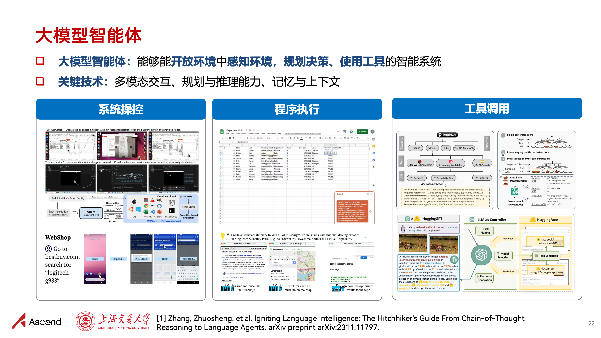

<h1 align="center">《Thực hành mô hình lớn》 — Loạt giáo trình thực hành lập trình</h1>

  	
  
  
   	
  	
    
     

  <a href="#động-lực-dự-án">Động lực dự án</a>/
  <a href="#mục-lục-giáo-trình">Mục lục giáo trình</a>/
  <a href="#danh-sách-người-đóng-góp">Danh sách người đóng góp</a>

## 💡 Cập nhật

2025/06/06  Cảm ơn sự quan tâm và phản hồi tích cực của tất cả các bạn! Chúng tôi đã cập nhật giáo trình trên hai phương diện sau:

- [x] Ra mắt giáo trình thiện nguyện 《Toàn bộ quy trình phát triển mô hình lớn》 phiên bản nội địa hóa (gồm PPT, sổ tay thí nghiệm và video), xin đặc biệt cảm ơn sự hỗ trợ của cộng đồng Huawei Ascend!
- [x] Cập nhật nội dung trên cơ sở loạt giáo trình thực hành lập trình ban đầu, đồng thời bổ sung các chủ đề mới (suy luận toán học, GUI Agent, căn chỉnh mô hình lớn, thuật giấu tin, v.v.)!

## 🎯 Động lực dự án

Loạt giáo trình thực hành lập trình 《Thực hành mô hình lớn》 được phát triển từ bài giảng của các môn 《Công nghệ tiên tiến trong xử lý ngôn ngữ tự nhiên》 (NIS8021) và 《Công nghệ an toàn trí tuệ nhân tạo》 (NIS3353) tại Đại học Giao thông Thượng Hải (giảng viên: [Trương Trác Thắng](https://bcmi.sjtu.edu.cn/home/zhangzs/)), nhằm cung cấp tài liệu tham khảo lập trình nhập môn về mô hình lớn. Giáo trình mang tính chất thiện nguyện và hoàn toàn miễn phí. Thông qua các bài thực hành đơn giản, giáo trình giúp các bạn sinh viên nhanh chóng nhập môn mô hình lớn, từ đó triển khai tốt hơn đồ án môn học hoặc nghiên cứu học thuật của mình.

## 📚 Mục lục giáo trình

| Nội dung giáo trình         | Giới thiệu                                                         | Địa chỉ                                                         |
| ---------------- | ------------------------------------------------------------ | ------------------------------------------------------------ |
| Tinh chỉnh và triển khai       | Hướng dẫn tinh chỉnh và triển khai mô hình tiền huấn luyện: Bạn muốn nâng cao hiệu năng của mô hình tiền huấn luyện trên một tác vụ chỉ định? Hãy cùng lựa chọn mô hình tiền huấn luyện phù hợp, tinh chỉnh nó trên tác vụ cụ thể, và triển khai mô hình sau tinh chỉnh thành một Demo dễ sử dụng! | [[Bài giảng](https://github.com/Lordog/dive-into-llms/tree/main/documents/chapter1/dive-into-llm.pdf)] [[Giáo trình](https://github.com/Lordog/dive-into-llms/tree/main/documents/chapter1/README.md)] [[Mã nguồn](https://github.com/Lordog/dive-into-llms/tree/main/documents/chapter1/dive-tuning.ipynb)] |
| Học gợi ý và chuỗi tư duy | Hướng dẫn gọi API và suy luận của mô hình lớn: "AI cầu xin lời động viên trực tuyến? Câu trả lời của mô hình lớn cho một số câu hỏi khiến người ta sững sờ, nhưng có lẽ nó chỉ muốn một câu「động viên」" | [[Bài giảng](https://github.com/Lordog/dive-into-llms/tree/main/documents/chapter2/dive-into-prompting.pdf)] [[Giáo trình](https://github.com/Lordog/dive-into-llms/tree/main/documents/chapter2/README.md)] [[Mã nguồn](https://github.com/Lordog/dive-into-llms/tree/main/documents/chapter2/dive-prompting.ipynb)] |
| Chỉnh sửa tri thức         | Phương pháp và công cụ chỉnh sửa mô hình ngôn ngữ: Bạn muốn thao túng ký ức của mô hình ngôn ngữ về một tri thức chỉ định? Hãy cùng lựa chọn phương pháp chỉnh sửa phù hợp, chỉnh sửa một tri thức cụ thể, rồi kiểm chứng mô hình sau khi chỉnh sửa! | [[Bài giảng](https://github.com/Lordog/dive-into-llms/blob/main/documents/chapter3/dive_edit_0410.pdf)] [[Giáo trình](https://github.com/Lordog/dive-into-llms/tree/main/documents/chapter3/README.md)]  [[Mã nguồn](https://github.com/Lordog/dive-into-llms/tree/main/documents/chapter3/dive_edit.ipynb)] |
| Suy luận toán học         | Làm thế nào để mô hình lớn học được suy luận toán học? Hãy cùng nhanh chóng chưng cất (distill) một R1 tí hon!         | [[Bài giảng](https://github.com/Lordog/dive-into-llms/blob/main/documents/chapter4/math.pdf)] [[Giáo trình](https://github.com/Lordog/dive-into-llms/tree/main/documents/chapter4/README.md)]  [[Mã nguồn](https://github.com/Lordog/dive-into-llms/blob/main/documents/chapter4/sft_math.ipynb)] |
| Thủy vân mô hình         | Thủy vân văn bản của mô hình ngôn ngữ: nhúng thủy vân mà con người không thể nhận biết vào nội dung do mô hình ngôn ngữ sinh ra | [[Bài giảng](https://github.com/Lordog/dive-into-llms/blob/main/documents/chapter5/watermark.pdf)] [[Giáo trình](https://github.com/Lordog/dive-into-llms/tree/main/documents/chapter5/README.md)]  [[Mã nguồn](https://github.com/Lordog/dive-into-llms/blob/main/documents/chapter5/watermark.ipynb)] |
| Tấn công jailbreak         | Muốn có bảo mật tốt hơn thì phải bắt đầu bằng việc học cách tấn công. Hãy cùng tìm hiểu cách tấn công jailbreak bẻ khóa miệng mô hình lớn! | [[Bài giảng](https://github.com/Lordog/dive-into-llms/blob/main/documents/chapter6/dive-Jailbreak.pdf)] [[Giáo trình](https://github.com/Lordog/dive-into-llms/tree/main/documents/chapter6/README.md)] [[Mã nguồn](https://github.com/Lordog/dive-into-llms/blob/main/documents/chapter6/dive-jailbreak.ipynb)] |
| Thuật giấu tin mô hình lớn       | "Mực vô hình"! Bạn muốn mô hình lớn vừa trả lời trôi chảy, vừa lặng lẽ mang theo thông tin mà chỉ "người trong nhà" mới nhận ra? Thuật giấu tin mô hình lớn sẽ cho bạn câu trả lời! | [[Bài giảng](https://github.com/Lordog/dive-into-llms/blob/main/documents/chapter7/stega.pdf)] [[Giáo trình](https://github.com/Lordog/dive-into-llms/tree/main/documents/chapter7/README.md)] [[Mã nguồn](https://github.com/Lordog/dive-into-llms/blob/main/documents/chapter7/llm_stega.ipynb)] |
| Mô hình đa phương thức       | Là mô hình ngôn ngữ lớn đa phương thức có thể mô phỏng thế giới thực đầy đủ hơn, nó làm thế nào để đạt được năng lực hiểu và sinh đa phương thức mạnh mẽ hơn? Liệu mô hình ngôn ngữ lớn đa phương thức có thể giúp hiện thực hóa AGI? | [[Bài giảng](https://github.com/Lordog/dive-into-llms/blob/main/documents/chapter8/mllms.pdf)]  [[Giáo trình](https://github.com/Lordog/dive-into-llms/tree/main/documents/chapter8/README.md)] [[Mã nguồn](https://github.com/Lordog/dive-into-llms/blob/main/documents/chapter8/mllms.ipynb)] |
| Tác tử GUI        | Muốn "cơm dâng tận miệng", giải phóng đôi tay? Vậy hãy cùng để AI Agent đặt đồ ăn giao tận nhà, trả lời tin nhắn, mua sắm so sánh giá thay bạn! | [[Bài giảng](https://github.com/Lordog/dive-into-llms/blob/main/documents/chapter9/GUIagent.pdf)]  [[Giáo trình](https://github.com/Lordog/dive-into-llms/tree/main/documents/chapter9/README.md)] [[Mã nguồn](https://github.com/Lordog/dive-into-llms/blob/main/documents/chapter9/GUIagent.ipynb)] |
| An toàn tác tử       | Tác tử mô hình lớn đang bước vào hành trình hướng tới hệ điều hành của tương lai. Tuy nhiên, trong bối cảnh tác tử mở, mô hình lớn có nhận thức được các mối đe dọa rủi ro hay không? | [[Bài giảng](https://github.com/Lordog/dive-into-llms/blob/main/documents/chapter10/dive-into-safety.pdf)] [[Giáo trình](https://github.com/Lordog/dive-into-llms/tree/main/documents/chapter10/README.md)] [[Mã nguồn](https://github.com/Lordog/dive-into-llms/blob/main/documents/chapter10/agent.ipynb)] |
| Căn chỉnh an toàn RLHF     | Hướng dẫn thí nghiệm RLHF dựa trên PPO: giáo trình này "cực kỳ nguy hiểm", sau khi đọc xong hãy kiểm tra xem mô hình lớn của bạn có đang cười lạnh hay không. | [[Bài giảng](https://github.com/Lordog/dive-into-llms/blob/main/documents/chapter11/RLHF.pdf)] [[Giáo trình](https://github.com/Lordog/dive-into-llms/tree/main/documents/chapter11/README.md)] [[Mã nguồn](https://github.com/Lordog/dive-into-llms/blob/main/documents/chapter11/RLHF.ipynb)] |

## 🔥 Mới ra mắt: 《Toàn bộ quy trình phát triển mô hình lớn》 phiên bản nội địa hóa

- **✨ Giáo trình thiện nguyện 《Toàn bộ quy trình phát triển mô hình lớn》 do chúng tôi phối hợp cùng Huawei Ascend ra mắt chính thức! Công nghệ tiên phong + thực hành mã nguồn, cầm tay chỉ việc đưa bạn làm chủ mô hình AI lớn ✨**:

  Trên cơ sở loạt giáo trình 《Thực hành mô hình lớn》 ban đầu, chúng tôi đã phối hợp với Huawei phát triển loạt khóa học 《Toàn bộ quy trình phát triển mô hình lớn》. Loạt giáo trình này được phát triển dựa trên phần cứng và phần mềm nền tảng Ascend, bao gồm các hình thức như PPT, sổ tay thí nghiệm, video. Giáo trình được chia thành các loạt sơ cấp, trung cấp và cao cấp, hướng tới những nhu cầu thực hành mô hình lớn khác nhau, nhằm đưa công nghệ tiên phong thông qua thực hành mã nguồn, cung cấp cho các nhà nghiên cứu, nhà phát triển liên quan một hướng dẫn phát triển toàn quy trình từ nông đến sâu để nhanh chóng bắt đầu, ứng dụng các mô hình đã được Ascend hỗ trợ và chuyển đổi, tinh chỉnh mô hình hoàn toàn mới.

- **🚀 Ghé thăm cộng đồng Ascend để khám phá loạt khóa học 《Toàn bộ quy trình phát triển mô hình lớn》**:

  👉《[Khu vực học tập phát triển mô hình lớn](https://www.hiascend.com/edu/growth/lm-development#classification-floor-1)》@ Cộng đồng Ascend 👈

- **✨ Giới thiệu nội dung khóa học ✨**

  <!-- 
  
  
   -->

  
  
  
  

## 🙏 Tuyên bố miễn trừ trách nhiệm

Toàn bộ nội dung của giáo trình này chỉ đến từ kinh nghiệm cá nhân của những người đóng góp, dữ liệu trên Internet và những tích lũy liên quan trong công việc nghiên cứu khoa học hằng ngày. Mọi kỹ thuật chỉ mang tính tham khảo, không đảm bảo đúng một trăm phần trăm. Nếu có bất kỳ vấn đề gì, hoan nghênh bạn gửi Issue hoặc PR. Ngoài ra, các huy hiệu (badge) được sử dụng trong dự án này đến từ Internet, nếu xâm phạm bản quyền hình ảnh của bạn, vui lòng liên hệ với chúng tôi để xóa, xin cảm ơn.

## 🤝 Hoan nghênh đóng góp

Giáo trình hiện là một dự án đang được triển khai, khó tránh khỏi thiếu sót, hoan nghênh mọi PR và thảo luận issue.

## ❤️ Danh sách người đóng góp

Cảm ơn các thầy cô và các bạn sau đây đã ủng hộ và đóng góp cho dự án này:

**Nhóm phát triển loạt giáo trình 《Thực hành mô hình lớn》**:

- Đại học Giao thông Thượng Hải: [Trương Trác Thắng](https://bcmi.sjtu.edu.cn/home/zhangzs/)、[Viên Đồng Hâm](https://github.com/Lordog)、[Mã Hân Bối](https://scholar.google.com/citations?user=LpUi3EgAAAAJ&hl=zh-CN&oi=ao)、 [Hà Chí Uy](https://zwhe99.github.io)、[Đỗ Nguy](https://scholar.google.com/citations?user=tFYUBLkAAAAJ&hl=en)、[Triệu Hạo Đông](https://dongdongzhaoup.github.io/)、[Ngô Tông Nho](https://zrw00.github.io/)、[Ngô Tranh](https://wuzheng02.github.io/)、[Đổng Lăng Chúng](https://github.com/LZ-Dong)、[Trương Ngọc Long](https://aslan-yulong.github.io/)

- Đại học Quốc gia Singapore: [Phí Hào](http://haofei.vip/)

**Nhóm phát triển loạt giáo trình 《Toàn bộ quy trình phát triển mô hình lớn》:**

- Đại học Giao thông Thượng Hải: [Trương Trác Thắng](https://bcmi.sjtu.edu.cn/home/zhangzs/)、[Lưu Công Thân](https://infosec.sjtu.edu.cn/DirectoryDetail.aspx?id=75)、[Trần Tinh Vũ](https://scholar.google.com/citations?user=d-dNtjrMJ5YC&hl=en)、[Trình Bành Châu](https://scholar.google.com/citations?user=qxnwzDUAAAAJ&hl=en)、[Đổng Lăng Chúng](https://github.com/LZ-Dong)、 [Hà Chí Uy](https://zwhe99.github.io)、[Cúc Thiên Kiệt](https://scholar.google.com/citations?user=f8PPcnoAAAAJ&hl=en)、[Mã Hân Bối](https://scholar.google.com/citations?user=LpUi3EgAAAAJ&hl=zh-CN&oi=ao)、 [Ngô Tranh](https://scholar.google.com/citations?hl=zh-CN&user=qBM1UbUAAAAJ&view_op=list_works&gmla=AIfU4H6PG9JyjRub6BYIIZ4isQE7MBAM3Eoec6OJfX4z_8-pOE8bI1Wgdo3XL5qOZWR3U-h-lIP2q0zXt5gzyFKMSg7MNnBBWLv5d1IVG30UANczTP0)、[Ngô Tông Nho](https://zrw00.github.io/)、[Diêm Tử Hách](https://scholar.google.com/citations?user=O2YfSHoAAAAJ&hl=zh-CN)、[Diêu Yểu](https://scholar.google.com/citations?user=tLMP3IkAAAAJ)、[Viên Đồng Hâm](https://github.com/Lordog)、[Triệu Hạo Đông](https://dongdongzhaoup.github.io/);

- Cộng đồng Huawei Ascend: ZOMI、Tạ Càn、Trình Lê Minh、Lâu Lê Hoa、Tiêu Trạch Dục

## 🌟 Lịch sử Star

