# Tinh chỉnh và triển khai mô hình ngôn ngữ tiền huấn luyện

> Dẫn đọc: Phần này giới thiệu việc tinh chỉnh mô hình tiền huấn luyện
Bạn muốn nâng cao hiệu năng của mô hình tiền huấn luyện trên một tác vụ chỉ định? Hãy cùng lựa chọn mô hình tiền huấn luyện phù hợp, tinh chỉnh nó trên tác vụ cụ thể, rồi triển khai mô hình sau tinh chỉnh thành một Demo dễ sử dụng!
## Mục tiêu của giáo trình:
1. Làm quen với việc sử dụng bộ công cụ Transformers
2. Nắm được việc tinh chỉnh và suy luận (inference) mô hình tiền huấn luyện (bản tách rời có thể tùy biến & bản tích hợp mặc định)
3. Nắm được cách triển khai Demo bằng Gradio Spaces
4. Hiểu việc lựa chọn các loại mô hình tiền huấn luyện khác nhau và bối cảnh ứng dụng của chúng
## Nội dung giáo trình:
### 1. Chuẩn bị công việc:
#### 1.1 Tìm hiểu bộ công cụ: Transformers
https://github.com/huggingface/transformers

> 🤗 Transformers cung cấp các API và công cụ cho phép dễ dàng tải xuống và huấn luyện những mô hình tiền huấn luyện tiên tiến. Sử dụng mô hình tiền huấn luyện có thể giảm chi phí tính toán và lượng khí thải carbon, đồng thời tiết kiệm thời gian và tài nguyên cần thiết để huấn luyện từ đầu. Những mô hình này hỗ trợ các tác vụ phổ biến trong nhiều phương thức (modality) khác nhau, chẳng hạn:
📝 Xử lý ngôn ngữ tự nhiên: phân loại văn bản, nhận dạng thực thể có tên, hỏi đáp, mô hình hóa ngôn ngữ, tóm tắt, dịch máy, trắc nghiệm nhiều lựa chọn và sinh văn bản.
🖼️ Thị giác máy tính: phân loại hình ảnh, phát hiện đối tượng và phân đoạn ngữ nghĩa.
🗣️ Âm thanh: nhận dạng tiếng nói tự động và phân loại âm thanh.
🐙 Đa phương thức: hỏi đáp trên bảng, nhận dạng ký tự quang học, trích xuất thông tin từ tài liệu quét, phân loại video và hỏi đáp thị giác.

Tài liệu tiếng Trung chi tiết: https://huggingface.co/docs/transformers/main/zh/index

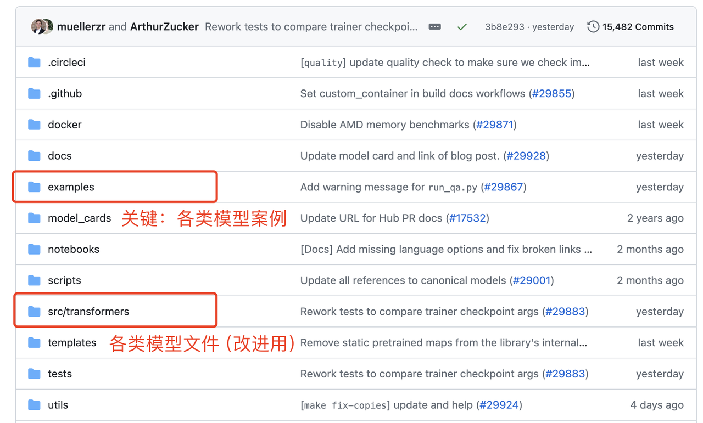

#### 1.2 Cài đặt môi trường: lấy phân loại văn bản (ví dụ: phát hiện tin giả) làm ví dụ
1. Chúng ta vào kho ví dụ phân loại văn bản, tham khảo readme để hiểu các tham số then chốt, tải requirements.txt và run_classification.py

https://github.com/huggingface/transformers/tree/main/examples/pytorch/text-classification

2. Cài đặt môi trường:
- 1. Tạo môi trường mới bằng conda: conda create -n llm python=3.9
- 2. Kích hoạt môi trường ảo: conda activate llm
- 3. pip install transformers
- 4. Xóa torch được tự động cài trong requirements.txt, rồi pip install -r requirements.txt

> Nếu tốc độ tải chậm, có thể dùng nguồn trong nước: pip [Packages] -i https://pypi.tuna.tsinghua.edu.cn/simple

> Nếu dùng nguồn trong nước để cài pytorch, pip sẽ tự động chọn bản pytorch CPU và không thể chạy trên GPU, vì vậy——

- 5. conda install pytorch

> Nếu tốc độ tải chậm, có thể cấu hình mirror conda theo bài blog này: https://blog.csdn.net/weixin_42797483/article/details/132048218

3. Chuẩn bị dữ liệu: chúng ta lấy bộ dữ liệu tweet giả trên Kaggle làm ví dụ: https://www.kaggle.com/c/nlp-getting-started/data

#### 1.3 Gói dự án đã xử lý sẵn (mã minh họa và dữ liệu)
(1) Bản tách rời có thể tùy biến (các mô-đun then chốt được tách rời, dễ hiểu, có thể tùy chỉnh việc nạp dữ liệu, cấu trúc mô hình, chỉ số đánh giá, v.v.)

[Liên kết tải TextClassificationCustom](https://pan.quark.cn/s/00dae5c2b128)

(2) Bản tích hợp mặc định (mã khá
phong phú và phức tạp, thường gọi trực tiếp bằng siêu tham số, có một chút ngưỡng cản về mặt phát triển)

[Liên kết tải TextClassification](https://pan.quark.cn/s/9d0510f1c98d)


### 2. Phát triển tùy chỉnh dựa trên bản tách rời (sản phẩm khả thi tối thiểu MVP)
Gồm ba tệp chính: main.py là chương trình chính, utils_data.py là tệp nạp và xử lý dữ liệu, modeling_bert.py là tệp cấu trúc mô hình

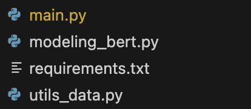

#### 2.1 Hiểu các mô-đun then chốt
1. Nạp và xử lý dữ liệu (utils_data.py)
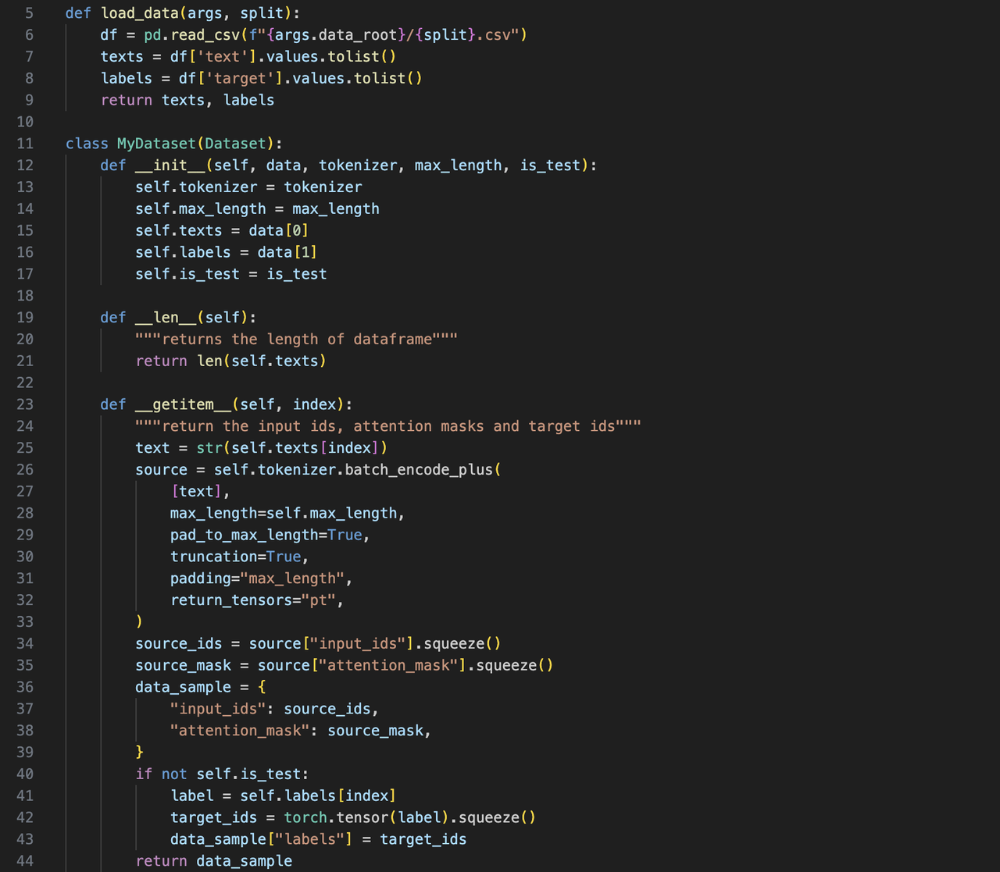

2. Nạp mô hình (modeling_bert.py)


3. Huấn luyện/đánh giá/dự đoán (main.py)

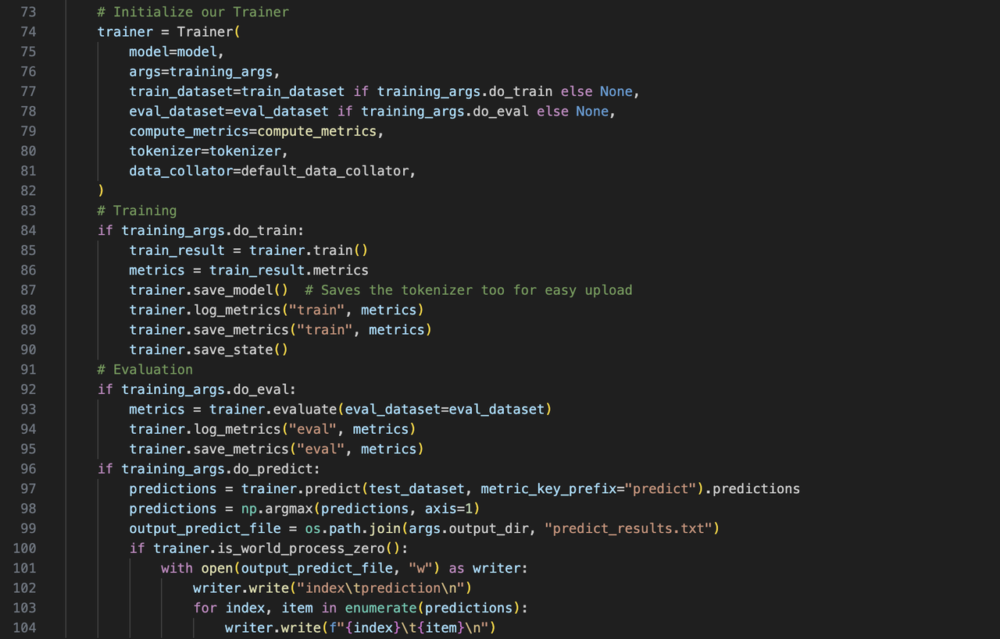

#### 2.2 Chạy trọn gói huấn luyện/đánh giá/dự đoán
```shell
python main.py
```

### 3. Tinh chỉnh dựa trên bản tích hợp (Tùy chọn, dựa trên run_classification.py)

#### 3.1 Hiểu các mô-đun then chốt:
1. Nạp dữ liệu (định dạng csv hoặc json)
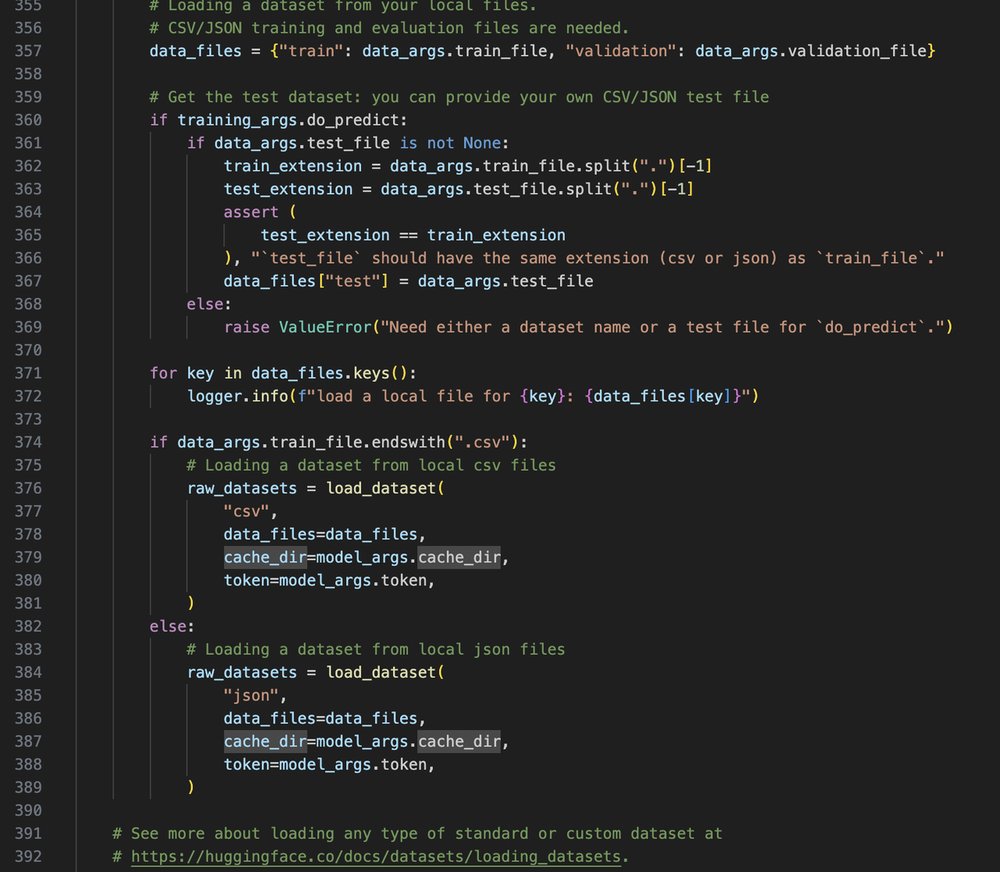

2. Xử lý dữ liệu
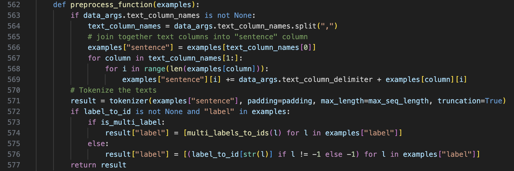

3. Nạp mô hình
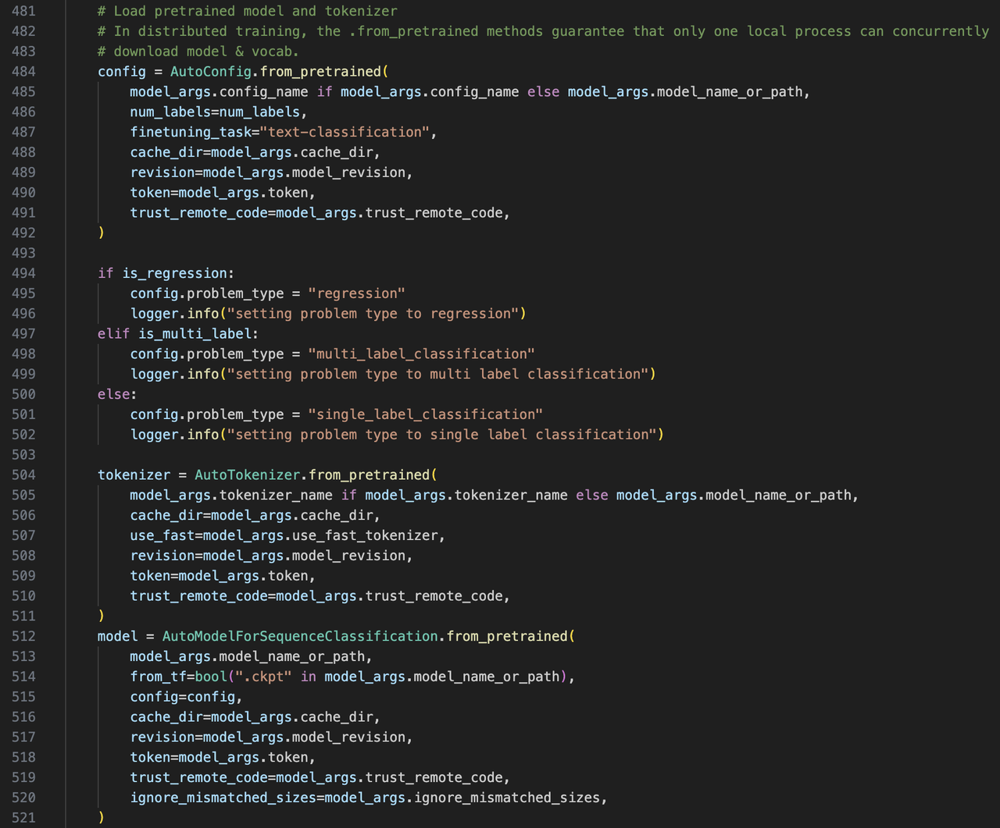

4. Huấn luyện/đánh giá/dự đoán
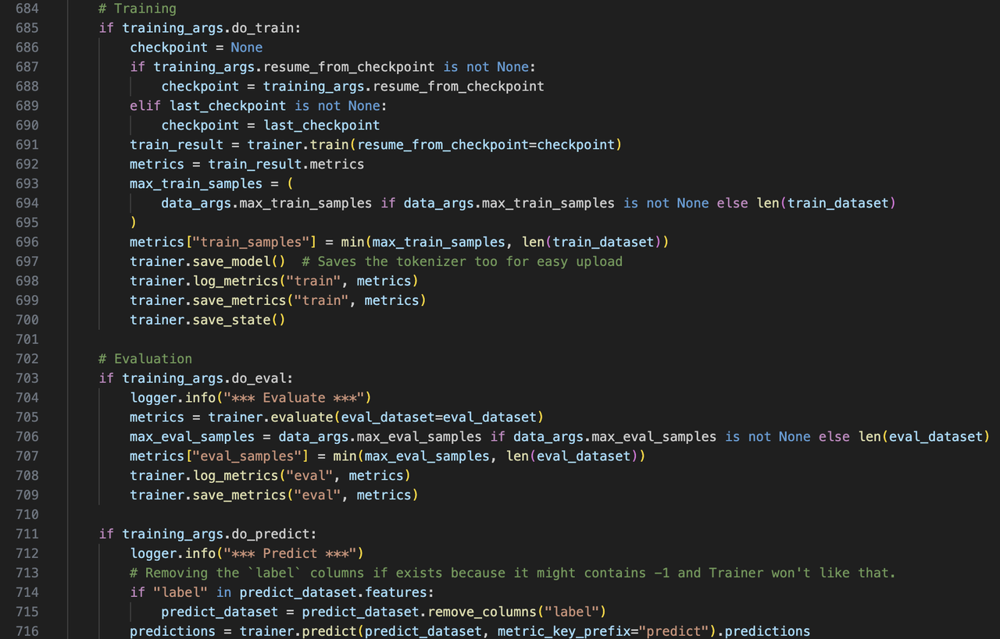

#### 3.2 Huấn luyện mô hình
Đồng thời đánh giá trên tập phát triển và dự đoán trên tập kiểm thử, thực thi đoạn script sau:

```shell
python run_classification.py \
    --model_name_or_path  bert-base-uncased \
    --train_file data/train.csv \
    --validation_file data/val.csv \
    --test_file data/test.csv \
    --shuffle_train_dataset \
    --metric_name accuracy \
    --text_column_name "text" \
    --text_column_delimiter "\n" \
    --label_column_name "target" \
    --do_train \
    --do_eval \
    --do_predict \
    --max_seq_length 512 \
    --per_device_train_batch_size 32 \
    --learning_rate 2e-5 \
    --num_train_epochs 1 \
    --output_dir experiments/
```

Nếu gặp báo lỗi hoặc bị treo, thường là vấn đề mạng:

1. <u>Khi tải mô hình hiển thị "Network is unreachable", hãy tải mô hình thủ công về máy: https://huggingface.co/google-bert/bert-base-uncased</u>
2. <u>Nếu sau khi nạp xong dữ liệu mà bị treo không chạy, nhấn CTRL+C để dừng và thấy treo ở "connection", thì đó là do gói evaluate không kết nối được mạng khi nạp chỉ số đánh giá.</u>

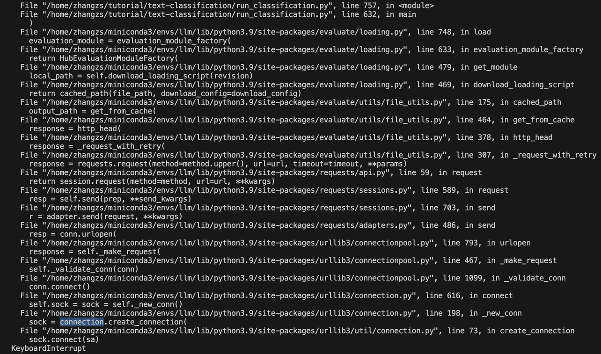

Khi đó, có thể vào GitHub của evaluate để tải toàn bộ gói: https://github.com/huggingface/evaluate/tree/main, và trong siêu tham số đổi đường dẫn --metric_name thành đường dẫn chỉ số cục bộ, tức là:

```shell
python run_classification.py \
    --model_name_or_path  bert-base-uncased \
    --train_file data/train.csv \
    --validation_file data/val.csv \
    --test_file data/test.csv \
    --shuffle_train_dataset \
    --metric_name evaluate/metrics/accuracy/accuracy.py \
    --text_column_name "text" \
    --text_column_delimiter "\n" \
    --label_column_name "target" \
    --do_train \
    --do_eval \
    --do_predict \
    --max_seq_length 512 \
    --per_device_train_batch_size 32 \
    --learning_rate 2e-5 \
    --num_train_epochs 1 \
    --output_dir experiments/
```

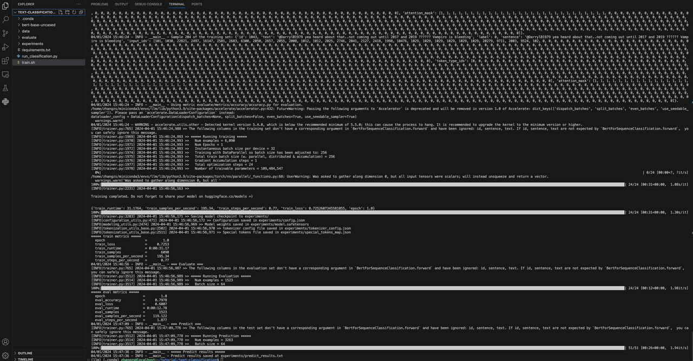


### 4. Triển khai mô hình: sau khi huấn luyện xong, chúng ta có thể dựng các demo trực tuyến trên Gradio Spaces
#### 4.1 Hướng dẫn Gradio Spaces
https://huggingface.co/docs/hub/en/spaces-sdks-gradio
#### 4.2 Tạo spaces
1. https://huggingface.co/new-space?sdk=gradio
2. Lưu ý: nếu không mở được, hãy thử truy cập qua VPN


#### 4.3 Mã suy luận then chốt
Chi tiết xem app.py trong gói dự án

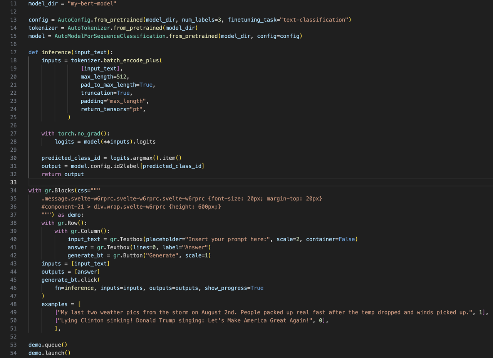

#### 4.4 Tải app.py, tệp cấu hình môi trường và mô hình lên Gradio Spaces
1. Tệp cấu hình (requirements.txt)
```r
transformers==4.30.2
torch==2.0.0
```

2. Tổng quan các tệp

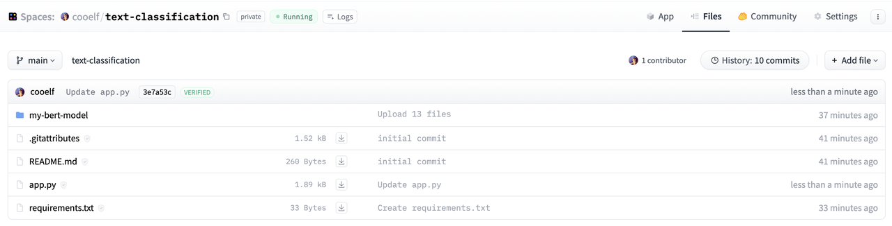


3. Hiệu quả Demo
Trường hợp đã triển khai thành công để tham khảo: https://huggingface.co/spaces/cooelf/text-classification
Trong đó, ở mục "Files" tại góc trên bên phải có thể xem mã nguồn.

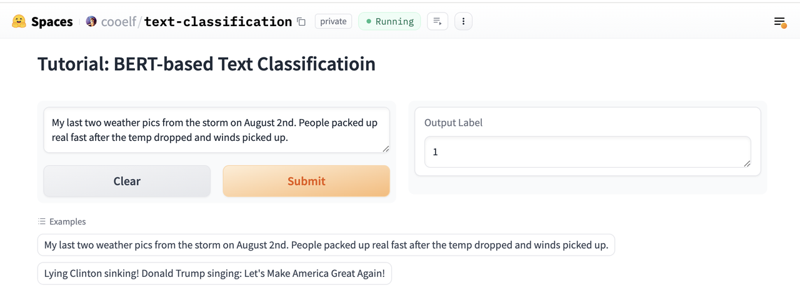


4. Bất ngờ thú vị: trên nền tảng Spaces có thể xem các Demo nổi bật hằng tuần, và có thể tìm kiếm những mô hình lớn, Demo mà bạn quan tâm để thử
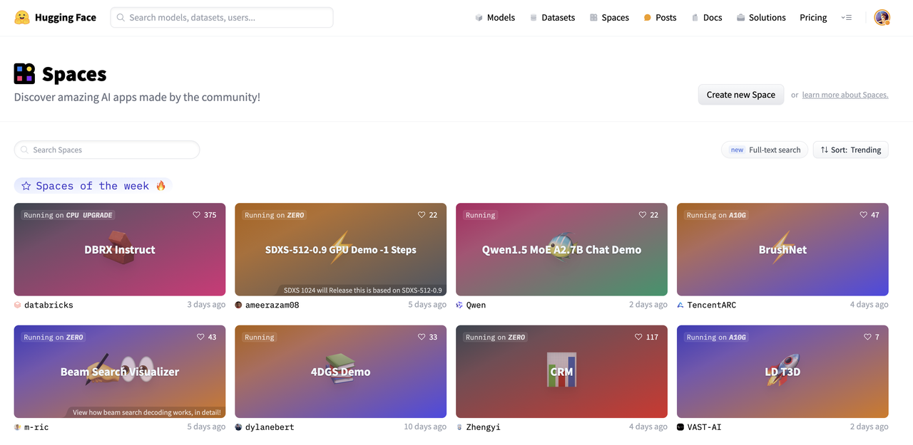


### 5. Bài tập nâng cao
1. Hãy thử các tác vụ phân loại/hồi quy khác, ví dụ phân loại cảm xúc, phân loại tin tức, phân loại lỗ hổng bảo mật, v.v.
2. Hãy thử các loại mô hình khác, ví dụ T5, ELECTRA, v.v.
### 6. Các mô hình thường dùng khác
1. Mô hình hỏi đáp: https://github.com/huggingface/transformers/tree/main/examples/pytorch/question-answering
2. Tóm tắt văn bản: https://github.com/huggingface/transformers/tree/main/examples/pytorch/summarization
3. Gọi Llama2 để suy luận: https://huggingface.co/docs/transformers/en/model_doc/llama2
4. Tinh chỉnh nhẹ Llama2 (LoRA):  https://github.com/peremartra/Large-Language-Model-Notebooks-Course/blob/main/5-Fine%20Tuning/LoRA_Tuning_PEFT.ipynb


### 7. Đọc thêm
1. Một bài [tổng quan](https://mp.weixin.qq.com/s?__biz=Mzk0MTYzMzMxMA==&mid=2247484539&idx=1&sn=6ee42baab4ad792e74ac6a89d7dd87d9&chksm=c2ce3e0af5b9b71c578cb6836e09cce5f60b4a1cfffadc1c4c98211fc0af621bfaaaa8fe0aff&mpshare=1&scene=24&srcid=0331FO6iqVqs5Vx3iHrtqouQ&sharer_shareinfo=45c3fb78d9cfb9627908da44dd7f5559&sharer_shareinfo_first=45c3fb78d9cfb9627908da44dd7f5559&key=a2847c972f830c4143e00e0430f657d8ab5acae4ad24ca628213273021453a3a9e17984627e2ab8506d1dcf6e1fabd9ec3123a5f71d2a65295ad6f6f56da2224d4a6e3228237c237447bbf48a6eff1f53e1971503f26c3fb5b9d99d27eca7266529a5f86d75bada7ec10bf314687bfcbf9fa3b09b8e36e73f6d6a154a5ce5ff0&ascene=14&uin=NzE3NzkyOTQx&devicetype=iMac20%2C1+OSX+OSX+14.2.1+build(23C71)&version=13080610&nettype=WIFI&lang=zh_CN&countrycode=CN&fontScale=100&exportkey=n_ChQIAhIQM7tgcovlhXp1y5J%2BRMnhfhL3AQIE97dBBAEAAAAAAFsTBwTm4FMAAAAOpnltbLcz9gKNyK89dVj0MxFZswDc%2Fk646vJPW2S3JFh8H2JhyZXiPbIl%2Bh23CsewrmIoZ4j0D2zMNylC3pLbhu9FIARUKYn%2F0r0OIdHnxesVFpw1qLo6uBJ3zmbsKBVXM05%2B0MiOBIfShfpiIfraK7THzak94U0RdS1flC%2BIDjTb5SmZs9Z4XTyTsN0QXR6NWjAXFeuxnMB4SENMJ8dUR8n08b3DGKtz9rfefn0JRlsX4mGcLvOFsFwg4nk35nl4C3Wgcs4OYociKm5UHabdhWT7%2FWbNNToZLD39eD%2FL4Xo%3D&acctmode=0&pass_ticket=8xG4QKOnJeEFUtXkScVmMqb3omdWJbPuc%2BhN5%2BA7%2FOXj7ex757M2ABNO4GVVnv2T3VtqrC9gZH%2FrU09rrUxJcA%3D%3D&wx_header=0) dài 43 trang phân tích toàn diện, sâu sắc về các mô hình ngôn ngữ lớn (LLM) (do tác giả của Word2Vec thực hiện)
   
    Tên bài báo: Large Language Models: A Survey

    Liên kết bài báo: https://arxiv.org/pdf/2402.06196.pdf

2. [Đọc kỹ bài báo GPT, GPT-2, GPT-3 【Đọc kỹ bài báo】](https://www.bilibili.com/video/BV1AF411b7xQ?t=0.0)

3. [Đọc kỹ bài báo InstructGPT 【Đọc kỹ bài báo·48】](https://www.bilibili.com/video/BV1hd4y187CR?t=0.4)
