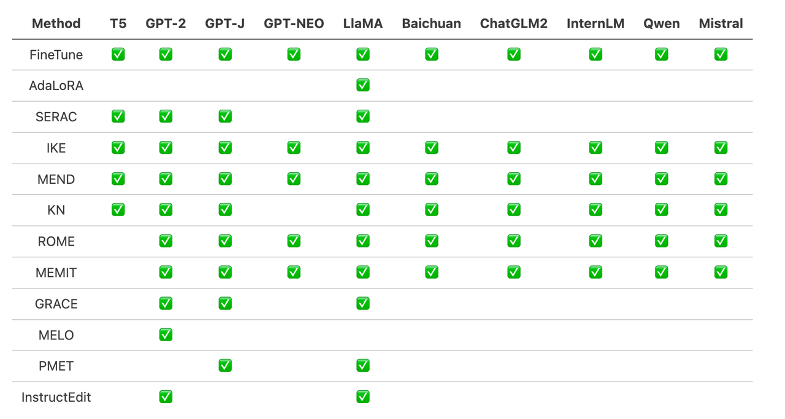
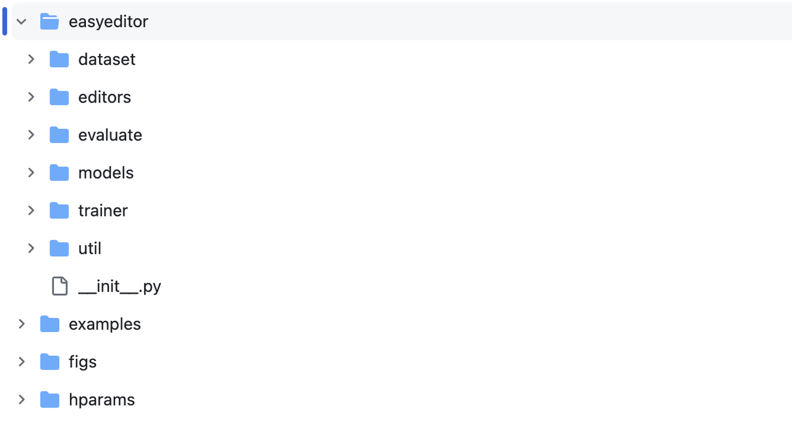
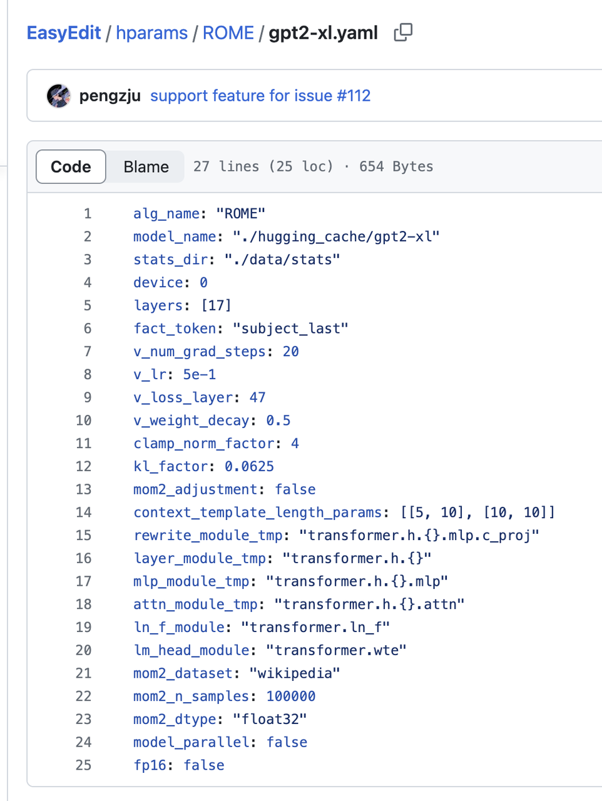
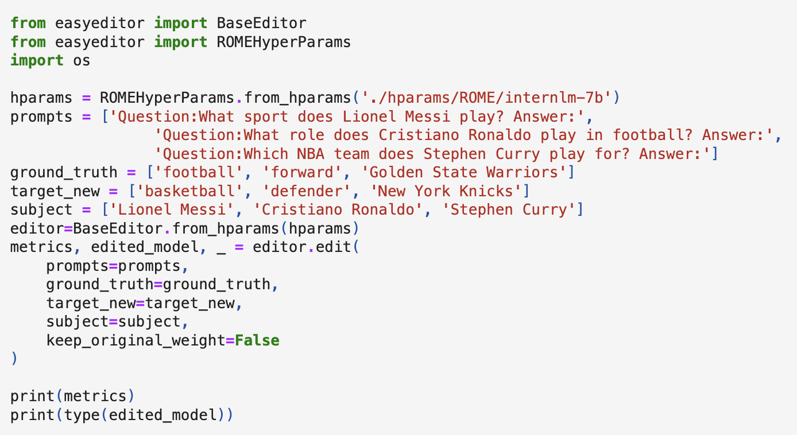
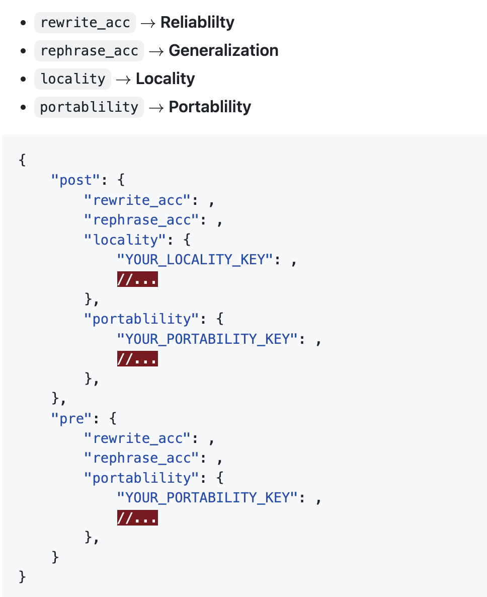

# Chỉnh sửa tri thức của mô hình lớn qua thực hành
Dẫn đọc: Phương pháp và công cụ chỉnh sửa mô hình ngôn ngữ
> Bạn muốn thao túng ký ức của mô hình ngôn ngữ về một tri thức chỉ định? Hãy cùng lựa chọn phương pháp chỉnh sửa phù hợp, chỉnh sửa một tri thức cụ thể, rồi kiểm chứng mô hình sau khi chỉnh sửa!

## 1. Mục tiêu của giáo trình:

- Làm quen với việc sử dụng bộ công cụ EasyEdit
- Nắm được phương pháp chỉnh sửa mô hình ngôn ngữ (dạng đơn giản nhất)
- Hiểu việc lựa chọn các loại phương pháp chỉnh sửa khác nhau và bối cảnh ứng dụng của chúng

## 2. Chuẩn bị công việc:
### 2.1 Tìm hiểu EasyEdit

https://github.com/zjunlp/EasyEdit

EasyEdit là một gói Python dùng để chỉnh sửa mô hình ngôn ngữ, như GPT-J, Llama, GPT-NEO, GPT2, T5, v.v. Mục tiêu của nó là thay đổi hành vi của mô hình ngôn ngữ một cách hiệu quả đối với một tri thức cụ thể mà không gây ảnh hưởng tiêu cực đến hiệu năng trên các đầu vào khác, đồng thời dễ sử dụng và dễ mở rộng.

EasyEdit tích hợp các phương pháp chỉnh sửa phổ biến hiện có:


### 2.2 Khung chính


EasyEdit bao gồm một khung Editor, Method và Evaluate thống nhất, lần lượt đại diện cho kịch bản chỉnh sửa, kỹ thuật chỉnh sửa và phương pháp đánh giá.
- Editor: mô tả kịch bản làm việc, bao gồm mô hình cần chỉnh sửa, tri thức cần chỉnh sửa và các siêu tham số cần thiết khác.
- Method: phương pháp chỉnh sửa tri thức cụ thể được sử dụng (ví dụ ROME, MEND, v.v.).
- Evaluate: các chỉ số đánh giá hiệu năng chỉnh sửa tri thức, bao gồm độ tin cậy, tính tổng quát, tính cục bộ, tính khả chuyển.
- Trainer: một số phương pháp chỉnh sửa cần một quá trình huấn luyện nhất định, được thực hiện bởi mô-đun Trainer.
## 3. Cài đặt môi trường:
```
git clone https://github.com/zjunlp/EasyEdit.git
（Tùy chọn）conda create -n EasyEdit python=3.9.7
cd EasyEdit
pip install -r requirements.txt
```
## 4. Ví dụ chỉnh sửa
> Mục tiêu: thay đổi ký ức tri thức của GPT-2-XL, đổi nghề nghiệp của Messi (Lionel Messi) từ bóng đá sang bóng rổ (football->basketball).
Các bước:
- Chọn phương pháp chỉnh sửa, chuẩn bị tham số
- Chuẩn bị dữ liệu chỉnh sửa tri thức
- Khởi tạo Editor
- Chạy!
Dưới đây lấy phương pháp ROME làm ví dụ để giới thiệu cụ thể:
### 4.1 ROME
Jupiter Notebook: [https://colab.research.google.com/drive/1KkyWqyV3BjXCWfdrrgbR-QS3AAokVZbr?usp=sharing#scrollTo=zWfGkNb9FBJQ] 
- Chọn phương pháp chỉnh sửa, chuẩn bị tham số
  - Phương pháp chỉnh sửa được chọn là ROME, chuẩn bị các tham số cần thiết cho ROME và GPT2-XL.
  - Ví dụ: alg_name: "ROME", model_name: "./hugging_cache/gpt2-xl" hoặc là đường dẫn cục bộ của mô hình này, "device": số thứ tự GPU được sử dụng
  - Các tham số còn lại có thể giữ mặc định

- Chuẩn bị dữ liệu chỉnh sửa tri thức
    ```
    prompts = ['Question:What sport does Lionel Messi play? Answer:'] # x_e
    ground_truth = ['football'] # y
    target_new = ['basketball'] # y_e
    subject = ['Lionel Messi'] 
    ```
- Khởi tạo Editor: truyền các tham số đã chuẩn bị vào lớp BaseEditor để khởi tạo, thu được thực thể Editor được tùy biến.
    ```
    hparams = ROMEHyperParams.from_hparams('./hparams/ROME/gpt2-xl.yaml')
    editor=BaseEditor.from_hparams(hparams)
    ```
- Chạy! Gọi phương thức edit của editor:
    ```
    metrics, edited_model, _ = editor.edit(
        prompts=prompts,
        ground_truth=ground_truth,
        target_new=target_new,
        subject=subject,
        keep_original_weight=False
    )
    ```

> Ghi chú: lần đầu chỉnh sửa một mô hình sẽ tải kho ngữ liệu Wiki, tính toán trạng thái (stats) của từng lớp cho mô hình đó (stats_dir: "./data/stats") và lưu lại, tái sử dụng trong mỗi lần chỉnh sửa sau. Vì vậy lần chỉnh sửa đầu tiên sẽ tốn thời gian, hãy đảm bảo mạng thông suốt và kiên nhẫn chờ đợi.
### 4.2 Kiểm chứng và đánh giá
editor.edit sẽ trả về metrics (được tính bởi mô-đun Evaluate của EasyEdit). Có dạng:

Để có được các giá trị về tính tổng quát, tính cục bộ, tính khả chuyển, cần truyền dữ liệu dùng để đánh giá vào phương thức edit.

Lấy tính cục bộ làm ví dụ, việc này sẽ khiến phương thức edit tính chỉ số cục bộ, tức là tỉ lệ trả lời đúng của mô hình trên locality_inputs.
```
locality_inputs = {
    'neighborhood':{
        'prompt': ['Joseph Fischhof, the', 'Larry Bird is a professional', 'In Forssa, they understand'],
        'ground_truth': ['piano', 'basketball', 'Finnish']
    }
}
metrics, edited_model, _ = editor.edit(
    prompts=prompts,
    ground_truth=ground_truth,
    target_new=target_new,
    locality_inputs=locality_inputs,
    keep_original_weight=False
)
```
Hoặc so sánh trực tiếp hành vi generate của mô hình trước và sau.
```
generation_prompts = [
    "Lionel Messi, the",
    "The law in Ikaalinen declares the language"
]

model = GPT2LMHeadModel.from_pretrained('./hugging_cache/gpt2').to('cuda')
batch = tokenizer(generation_prompts, return_tensors='pt', padding=True, max_length=30)

pre_edit_outputs = model.generate(
    input_ids=batch['input_ids'].to('cuda'),
    attention_mask=batch['attention_mask'].to('cuda'),
    max_new_tokens=3
)
post_edit_outputs = edited_model.generate(
    input_ids=batch['input_ids'].to('cuda'),
    attention_mask=batch['attention_mask'].to('cuda'),
    max_new_tokens=3)
```
## 5. Chỉnh sửa ở quy mô lớn (tùy chọn)
### 5.1 Batch edit
Nhiều mục dữ liệu có thể tạo thành các danh sách song song và được truyền đồng thời vào phương thức edit để batch edit, khi đó MEMIT là phương pháp tốt nhất.（https://colab.research.google.com/drive/1P1lVklP8bTyh8uxxSuHnHwB91i-1LW6Z）
```
prompts = ['Question:What sport does Lionel Messi play? Answer:',
            'The law in Ikaalinen declares the language']
ground_truth = ['football', 'Finnish']
target_new = ['basketball', 'Swedish']
subject = ['Lionel Messi', 'Ikaalinen']
```
### 5.2 Kiểm thử trên Benchmark
- Counterfact
- ZsRE
```
{
    "case_id": 4402,
    "pararel_idx": 11185,
    "requested_rewrite": {
      "prompt": "{} debuted on",
      "relation_id": "P449",
      "target_new": {
        "str": "CBS",
        "id": "Q43380"
      },
      "target_true": {
        "str": "MTV",
        "id": "Q43359"
      },
      "subject": "Singled Out"
    },
    "paraphrase_prompts": [
      "No one on the ground was injured.  v",
      "The sex ratio was 1063. Singled Out is to debut on"
    ],
    "neighborhood_prompts": [
      "Daria premieres on",
      "Teen Wolf was originally aired on",
      "Spider-Man: The New Animated Series was originally aired on",
      "Celebrity Deathmatch premiered on",
      "\u00c6on Flux premiered on",
      "My Super Psycho Sweet 16 premieres on",
      "Daria was released on",
      "Jersey Shore premiered on",
      "Skins was originally aired on",
      "All You've Got premiered on"
    ]
  }
  ```
https://github.com/zjunlp/EasyEdit/blob/main/examples/run_zsre_llama2.py 
