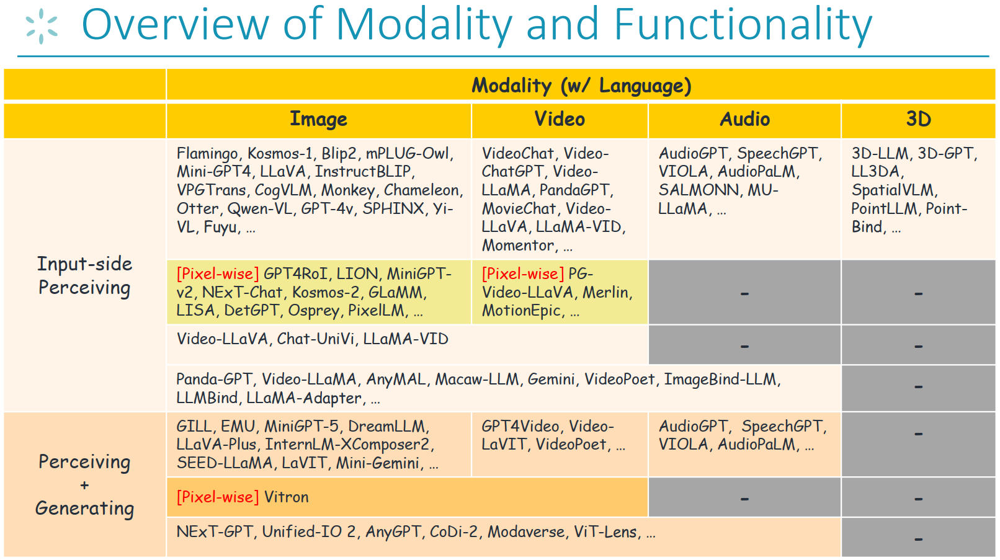
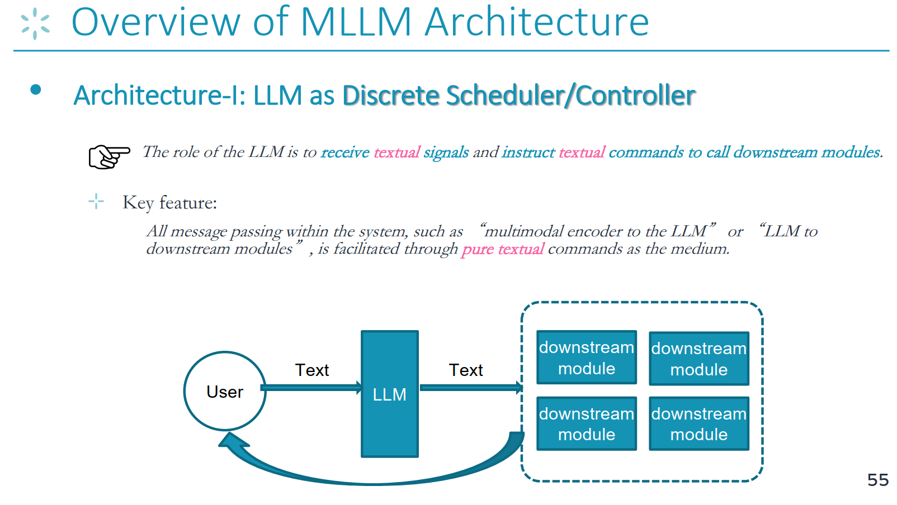
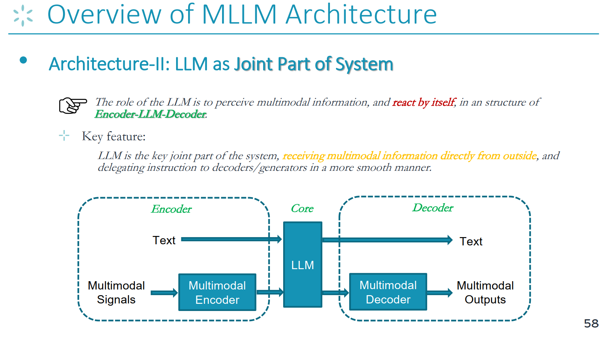
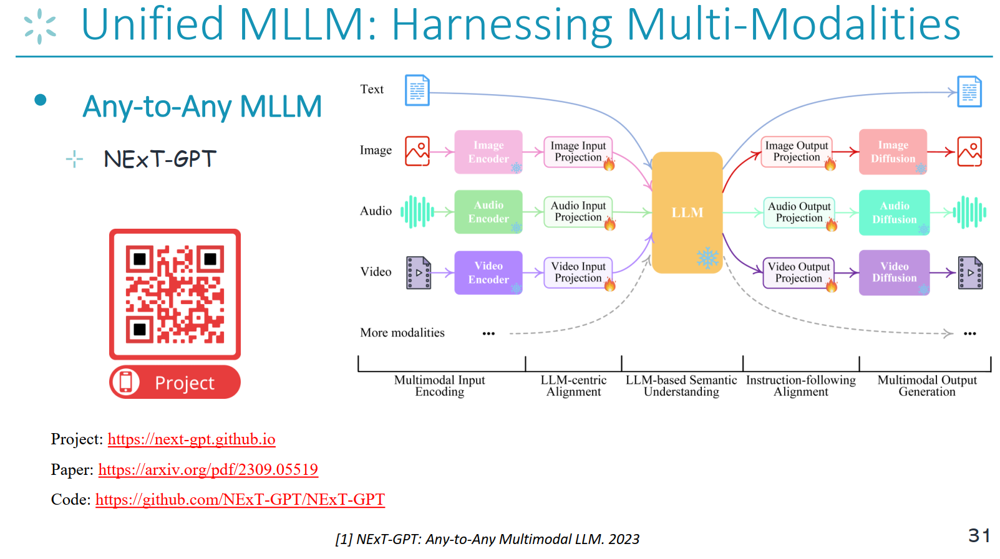
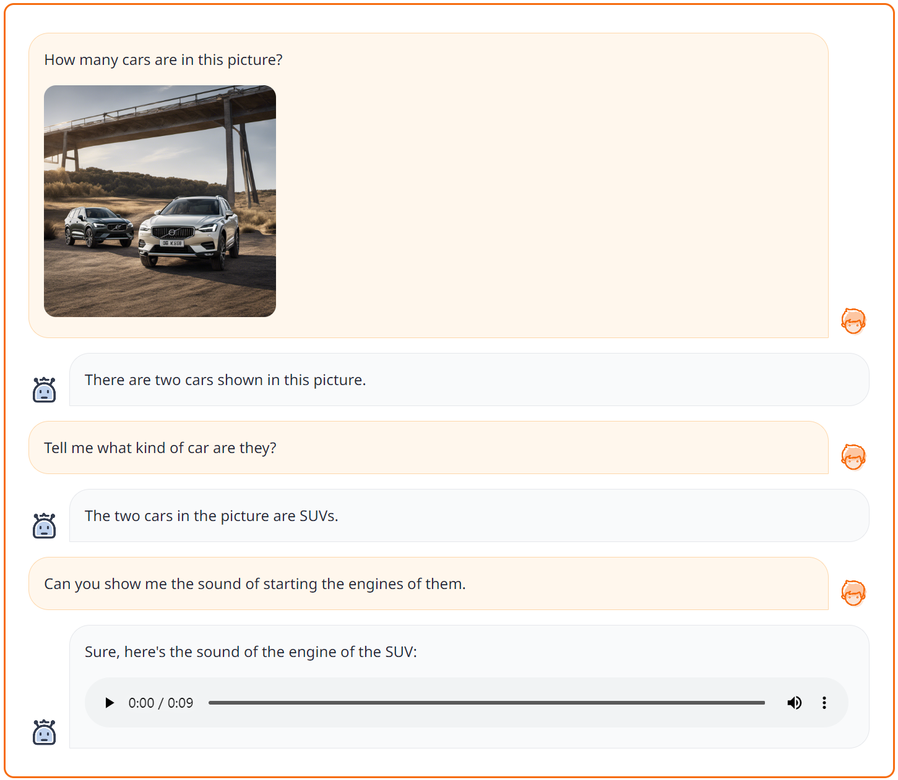
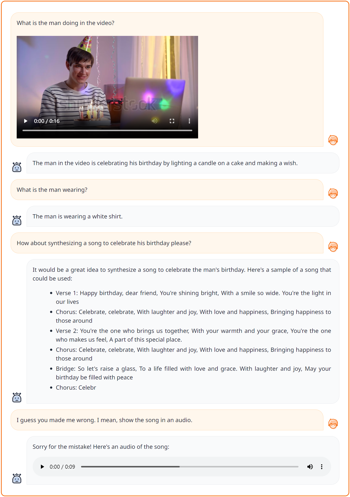
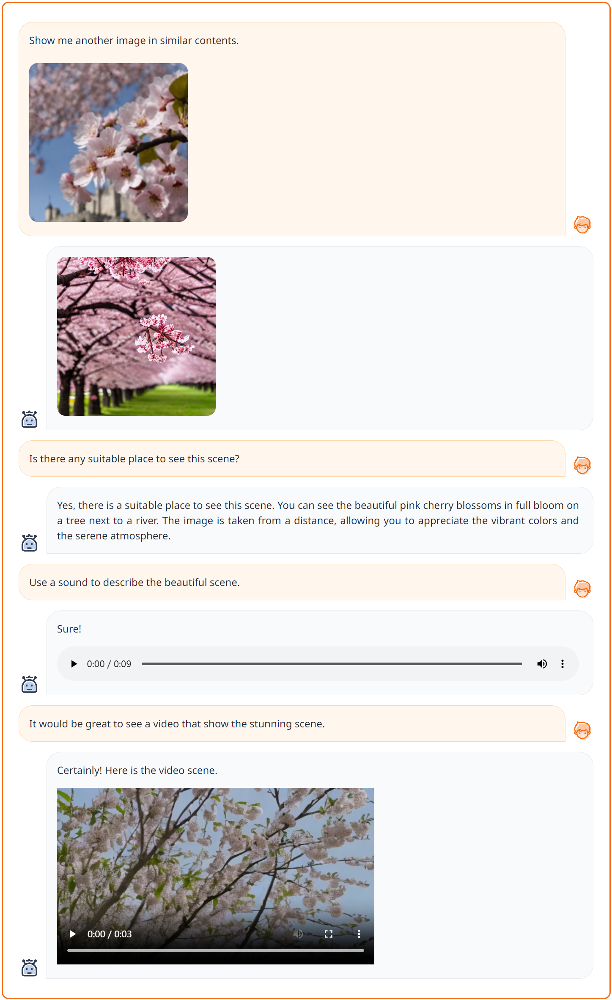

# Thực hành mô hình lớn: Mô hình ngôn ngữ lớn đa phương thức

Dẫn đọc: Phần này giới thiệu kiến trúc phổ biến và phương pháp xây dựng mô hình ngôn ngữ lớn đa phương thức

> Sự xuất hiện của mô hình ngôn ngữ lớn cho mọi người thấy rằng trí tuệ bậc cao đã được thể hiện đầy đủ trên phương thức ngôn ngữ. Là mô hình ngôn ngữ lớn đa phương thức có thể mô phỏng thế giới thực đầy đủ hơn, nó làm thế nào để đạt được năng lực hiểu và sinh đa phương thức mạnh mẽ hơn? Liệu mô hình ngôn ngữ lớn đa phương thức có thể giúp hiện thực hóa AGI?


## Mục tiêu của giáo trình

1. Làm quen với các loại mô hình ngôn ngữ lớn đa phương thức
2. Nắm được khung kỹ thuật tổng quát của mô hình ngôn ngữ lớn đa phương thức
3. Nắm được việc xây dựng, huấn luyện và suy luận mô hình ngôn ngữ lớn đa phương thức


## 1. Chuẩn bị kiến thức lý thuyết


### 1.1 Tìm hiểu các loại mô hình ngôn ngữ lớn đa phương thức

- Phân loại các mô hình ngôn ngữ lớn đa phương thức hiện có theo chức năng và phương thức được hỗ trợ


> Trước khi xây dựng mô hình ngôn ngữ lớn đa phương thức (MLLM), các nhà nghiên cứu trong lĩnh vực này đều đã đạt được một đồng thuận, một tiền đề then chốt: nhờ định luật về quy mô (scaling law) và các hiện tượng mới nổi (emergent phenomena), các LLM dựa trên ngôn ngữ hiện nay đã có năng lực hiểu ngữ nghĩa mạnh mẽ, điều này có nghĩa ngôn ngữ đã trở thành phương thức then chốt mang trí tuệ, vì vậy trí tuệ ngôn ngữ được coi là trung tâm (hub) của trí tuệ đa phương thức. Do đó, gần như tất cả MLLM đều được xây dựng trên nền LLM dựa trên ngôn ngữ, với LLM đóng vai mô-đun ra quyết định cốt lõi, tương tự bộ não hay bộ xử lý trung tâm. Nói cách khác, bằng việc thêm các mô-đun hoặc bộ mã hóa bên ngoài dành cho phương thức phi văn bản, LLM được trao cho năng lực nhận thức/thao tác đa phương thức.

Chúng tôi phân chia các MLLM hiện có thành các loại khác nhau dựa trên khả năng hỗ trợ phương thức và chức năng của chúng.




- Đọc giáo trình đầy đủ: [[Slides](https://github.com/Lordog/dive-into-llms/blob/main/documents/chapter6/mllms.pdf)] 


- Các bài tổng quan liên quan khác
    - [A Survey on Multimodal Large Language Models, https://github.com/BradyFU/Awesome-Multimodal-Large-Language-Models, 2023](https://github.com/BradyFU/Awesome-Multimodal-Large-Language-Models)
    - [MM-LLMs: Recent Advances in MultiModal Large Language Models, 2023](https://arxiv.org/pdf/2401.13601)


### 1.2 Tìm hiểu khung kỹ thuật tổng quát của mô hình ngôn ngữ lớn đa phương thức


- Kiến trúc 1: LLM as Task Scheduler (LLM là bộ lập lịch tác vụ)

> Hiện cộng đồng có hai kiến trúc MLLM phổ biến.
Loại thứ nhất là kiến trúc "LLM đóng vai bộ lập lịch/bộ điều khiển rời rạc". Như hình dưới đây, vai trò của LLM là tiếp nhận tín hiệu văn bản và phát lệnh văn bản xuống các mô-đun phía sau. Mọi việc truyền thông điệp bên trong hệ thống đều được thực hiện với lệnh văn bản thuần do LLM xuất ra làm phương tiện. Giữa các mô-đun chức năng khác nhau không có tương tác.




- Kiến trúc 2: LLM as Joint Part of System (LLM là phần ghép chung của hệ thống)

> Loại thứ hai là khung bộ mã hóa - LLM - bộ giải mã.
Đây cũng là kiến trúc phổ biến nhất hiện nay. Trong đó vai trò của LLM là nhận thức thông tin đa phương thức, và tự đưa ra phản hồi cùng thao tác trong một cấu trúc bộ mã hóa - LLM - bộ giải mã. Vì vậy, khác biệt then chốt giữa kiến trúc này và kiến trúc ở chương một là: LLM là phần ghép then chốt của hệ thống, trực tiếp tiếp nhận thông tin đa phương thức từ bên ngoài và ủy thác chỉ thị cho bộ giải mã/bộ sinh theo cách trôi chảy hơn. Trong khung bộ mã hóa - LLM - bộ giải mã, như hình dưới đây, bộ mã hóa xử lý tín hiệu mã hóa đến từ nhiều phương thức, LLM đóng vai người ra quyết định cốt lõi, còn bộ giải mã quản lý đầu ra đa phương thức.




## 2. Thực hành mô hình ngôn ngữ lớn đa phương thức tổng quát

> Thực hành quá trình xây dựng mô hình ngôn ngữ lớn đa phương thức tổng quát "từ phương thức bất kỳ sang phương thức bất kỳ"


### 2.1 Mô hình ngôn ngữ lớn đa phương thức "từ bất kỳ đến bất kỳ phương thức" hướng tới sự tổng quát, thống nhất: NExT-GPT

> Nghiên cứu MLLM trong tương lai chắc chắn sẽ phát triển theo hướng ngày càng tổng quát (generalist), do đó sẽ bao gồm càng nhiều phương thức và chức năng càng tốt. NExT-GPT là một trong những công trình mang tính khai phá nhất trong lĩnh vực này hiện nay, lần đầu tiên giới thiệu khái niệm MLLM "từ phương thức bất kỳ đến phương thức bất kỳ". Kiến trúc này hiện thực được những chức năng mạnh mẽ, đặt nền tảng cho hướng nghiên cứu mô hình ngôn ngữ lớn đa phương thức trong tương lai.




> Phần thực hành mã nguồn về mô hình ngôn ngữ lớn đa phương thức của bài học này sẽ lấy mã nguồn NExT-GPT làm đối tượng, tiến hành phân tích và thực hành đi từ sâu đến dễ hiểu.

[NExT-GPT Project](https://next-gpt.github.io/)

[Kho mã NExT-GPT trên GitHub](https://github.com/NExT-GPT/NExT-GPT)


### 2.2 Xem qua khung mã nguồn


```
├── figures
├── data
│   ├── T-X_pair_data  
│   │   ├── audiocap                      # text-autio pairs data
│   │   │   ├── audios                    # audio files
│   │   │   └── audiocap.json             # the audio captions
│   │   ├── cc3m                          # text-image paris data
│   │   │   ├── images                    # image files
│   │   │   └── cc3m.json                 # the image captions
│   │   └── webvid                        # text-video pairs data
│   │   │   ├── videos                    # video files
│   │   │   └── webvid.json               # the video captions
│   ├── IT_data                           # instruction data
│   │   ├── T+X-T_data                    # text+[image/audio/video] to text instruction data
│   │   │   ├── alpaca                    # textual instruction data
│   │   │   ├── llava                     # visual instruction data
│   │   ├── T-T+X                         # synthesized text to text+[image/audio/video] instruction data
│   │   └── MosIT                         # Modality-switching Instruction Tuning instruction data
├── code
│   ├── config
│   │   ├── base.yaml                     # the model configuration 
│   │   ├── stage_1.yaml                  # enc-side alignment training configuration
│   │   ├── stage_2.yaml                  # dec-side alignment training configuration
│   │   └── stage_3.yaml                  # instruction-tuning configuration
│   ├── dsconfig
│   │   ├── stage_1.json                  # deepspeed configuration for enc-side alignment training
│   │   ├── stage_2.json                  # deepspeed configuration for dec-side alignment training
│   │   └── stage_3.json                  # deepspeed configuration for instruction-tuning training
│   ├── datast
│   │   ├── base_dataset.py
│   │   ├── catalog.py                    # the catalog information of the dataset
│   │   ├── cc3m_datast.py                # process and load text-image pair dataset
│   │   ├── audiocap_datast.py            # process and load text-audio pair dataset
│   │   ├── webvid_dataset.py             # process and load text-video pair dataset
│   │   ├── T+X-T_instruction_dataset.py  # process and load text+x-to-text instruction dataset
│   │   ├── T-T+X_instruction_dataset.py  # process and load text-to-text+x instruction dataset
│   │   └── concat_dataset.py             # process and load multiple dataset
│   ├── model                     
│   │   ├── ImageBind                     # the code from ImageBind Model
│   │   ├── common
│   │   ├── anyToImageVideoAudio.py       # the main model file
│   │   ├── agent.py
│   │   ├── modeling_llama.py
│   │   ├── custom_ad.py                  # the audio diffusion 
│   │   ├── custom_sd.py                  # the image diffusion
│   │   ├── custom_vd.py                  # the video diffusion
│   │   ├── layers.py                     # the output projection layers
│   │   └── ...  
│   ├── scripts
│   │   ├── train.sh                      # training NExT-GPT script
│   │   └── app.sh                        # deploying demo script
│   ├── header.py
│   ├── process_embeddings.py             # precompute the captions embeddings
│   ├── train.py                          # training
│   ├── inference.py                      # inference
│   ├── demo_app.py                       # deploy Gradio demonstration 
│   └── ...
├── ckpt                           
│   ├── delta_ckpt                        # tunable NExT-GPT params
│   │   ├── nextgpt         
│   │   │   ├── 7b_tiva_v0                # the directory to save the log file
│   │   │   │   ├── log                   # the logs
│   └── ...       
│   ├── pretrained_ckpt                   # frozen params of pretrained modules
│   │   ├── imagebind_ckpt
│   │   │   ├──huge                       # version
│   │   │   │   └──imagebind_huge.pth
│   │   ├── vicuna_ckpt
│   │   │   ├── 7b_v0                     # version
│   │   │   │   ├── config.json
│   │   │   │   ├── pytorch_model-00001-of-00002.bin
│   │   │   │   ├── tokenizer.model
│   │   │   │   └── ...
├── LICENCE.md
├── README.md
└── requirements.txt
```


### 2.3 Cài đặt môi trường

Trước tiên hãy clone kho mã và cài đặt môi trường cần thiết, có thể hoàn tất việc cài đặt môi trường bằng cách chạy các lệnh sau:

```
conda env create -n nextgpt python=3.8

conda activate nextgpt

# CUDA 11.6
conda install pytorch==1.13.1 torchvision==0.14.1 torchaudio==0.13.1 pytorch-cuda=11.6 -c pytorch -c nvidia

git clone https://github.com/NExT-GPT/NExT-GPT.git
cd NExT-GPT

pip install -r requirements.txt
```


### 2.4 Bắt đầu suy luận với hệ thống


#### 2.4.1 Nạp checkpoint của mô hình NExT-GPT đã tiền huấn luyện

- **Bước 1**: nạp `tham số đóng băng`. [NExT-GPT](https://github.com/NExT-GPT/NExT-GPT) được huấn luyện trên cơ sở các mô hình hoặc mô-đun hiện có sau đây, vui lòng chuẩn bị checkpoint theo hướng dẫn dưới đây.
    - `ImageBind` là bộ mã hóa thống nhất cho hình ảnh/video/âm thanh. Có thể tải checkpoint tiền huấn luyện từ [đây](https://dl.fbaipublicfiles.com/imagebind/imagebind_huge.pth), phiên bản `huge`. Sau đó, đặt tệp `imagebind_huge.pth` vào [[./ckpt/pretrained_ckpt/imagebind_ckpt/huge]](ckpt/pretrained_ckpt/imagebind_ckpt/).
    - `Vicuna`: trước tiên chuẩn bị LLaMA theo hướng dẫn [[tại đây]](ckpt/pretrained_ckpt/prepare_vicuna.md). Sau đó đặt mô hình tiền huấn luyện vào [[./ckpt/pretrained_ckpt/vicuna_ckpt/]](ckpt/pretrained_ckpt/vicuna_ckpt/).
    - `Image Diffusion` dùng để sinh hình ảnh. NExT-GPT sử dụng [Stable Diffusion](https://huggingface.co/runwayml/stable-diffusion-v1-5) phiên bản `v1-5`. (_sẽ được tự động tải trong mã_)
    - `Audio Diffusion` dùng để sinh nội dung âm thanh. NExT-GPT sử dụng [AudioLDM](https://github.com/haoheliu/AudioLDM) phiên bản `l-full`. (_sẽ được tự động tải trong mã_)
    - `Video Diffusion` dùng để sinh video. Chúng tôi sử dụng [ZeroScope](https://huggingface.co/cerspense/zeroscope_v2_576w) phiên bản `v2_576w`. (_sẽ được tự động tải trong mã_)

- **Bước 2**: nạp `tham số có thể điều chỉnh`.

Đặt hệ thống NExT-GPT vào [[./ckpt/delta_ckpt/nextgpt/7b_tiva_v0]](./ckpt/delta_ckpt/nextgpt/7b_tiva_v0). Có thể chọn 1) dùng tham số do bạn tự huấn luyện, hoặc 2) tải checkpoint đã tiền huấn luyện sẵn từ [Huggingface](https://huggingface.co/ChocoWu/nextgpt_7b_tiva_v0).


#### 2.4.2 Triển khai Gradio Demo

Sau khi nạp xong checkpoint, bạn có thể chạy demo cục bộ theo cách sau:
```angular2html
cd ./code
bash scripts/app.sh
```
Các tham số then chốt cần chỉ định như sau:
- `--nextgpt_ckpt_path`: đường dẫn tới tham số NExT-GPT đã tiền huấn luyện.


#### 2.4.3 Thực hành với các ví dụ kiểm thử

Phiên bản hiện tại có thể hỗ trợ đầu vào là tổ hợp bất kỳ của bốn phương thức văn bản, hình ảnh, video, âm thanh, và đầu ra là tổ hợp phương thức của tác vụ.
Đồng thời hỗ trợ tương tác ngữ cảnh nhiều lượt.

Mời các bạn tự chạy để xem hiệu quả kiểm thử.

- **Case-1**: đầu vào T+I, đầu ra T+A




- **Case-2**: đầu vào T+V, đầu ra T+A




- **Case-3**: đầu vào T+I, đầu ra T+I+V




- **Case-4**: đầu vào T, đầu ra T+I+V+A


### 2.5 Quá trình huấn luyện hệ thống


#### 2.5.1 Chuẩn bị dữ liệu

Vui lòng tải các bộ dữ liệu dùng cho huấn luyện mô hình sau đây:

A) Dữ liệu cặp T-X
  - Dữ liệu `CC3M` của cặp ***văn bản - hình ảnh***, vui lòng làm theo hướng dẫn này [[tại đây]](./data/T-X_pair_data/cc3m/prepare.md). Sau đó đặt dữ liệu vào [[./data/T-X_pair_data/cc3m]](./data/T-X_pair_data/cc3m).
  - Dữ liệu `WebVid` của cặp ***văn bản - video***, tham khảo [[hướng dẫn]](./data/T-X_pair_data/webvid/prepare.md). Tệp nên được lưu tại [[./data/T-X_pair_data/webvid]](./data/T-X_pair_data/webvid).
  - Dữ liệu `AudioCap` của cặp ***văn bản - âm thanh***, tham khảo [[hướng dẫn]](./data/T-X_pair_data/audiocap/prepare.md). Lưu dữ liệu tại [[./data/T-X_pair_data/audiocap]](./data/T-X_pair_data/audiocap).

B) Dữ liệu tinh chỉnh theo chỉ thị
  - T+X-T
    - ***Dữ liệu chỉ thị thị giác*** (từ `LLaVA`), tải từ [đây](https://github.com/haotian-liu/LLaVA/blob/main/docs/Data.md), và đặt vào [[./data/IT_data/T+X-T_data/llava]](./data/IT_data/T+X-T_data/llava/).
    - ***Dữ liệu chỉ thị văn bản*** (từ `Alpaca`), tải từ [đây](https://github.com/tatsu-lab/stanford_alpaca), và đặt vào [[./data/IT_data/T+X-T_data/alpaca/]](data/IT_data/T+X-T_data/alpaca/).
    - ***Dữ liệu chỉ thị video*** (từ `VideoChat`), tải từ [đây](https://github.com/OpenGVLab/InternVideo/tree/main/Data/instruction_data), và đặt vào [[./data/IT_data/T+X-T_data/videochat/]](data/IT_data/T+X-T_data/videochat/).

    Lưu ý: sau khi tải bộ dữ liệu, vui lòng chạy `preprocess_dataset.py` để tiền xử lý bộ dữ liệu, làm cho định dạng thống nhất.
  - T-X+T (T2M)
    - Bộ dữ liệu chỉ thị `T-X+T` (T2M) được lưu tại [[./data/IT_data/T-T+X_data]](./data/IT_data/T-T+X_data).
   
  - MosIT
    - Xem hướng dẫn tải dữ liệu từ [đây](./data/IT_data/MosIT_data/). Cuối cùng đặt nó vào [[./data/IT_data/MosIT_data/]](./data/IT_data/MosIT_data/).


#### 2.5.2 Chuẩn bị vector nhúng

Trong huấn luyện căn chỉnh phía bộ giải mã của NExT-GPT, chúng tôi tối thiểu hóa khoảng cách giữa biểu diễn của Signal Token và của captions. Để đảm bảo hiệu quả cao của hệ thống, tiết kiệm thời gian và chi phí bộ nhớ, chúng tôi sử dụng bộ mã hóa văn bản trong từng mô hình khuếch tán (diffusion) để tính trước phần nhúng văn bản của chú thích hình ảnh, âm thanh và video.

Trước khi tiến hành huấn luyện NExT-GPT, vui lòng chạy các lệnh sau, tệp `embedding` được sinh ra sẽ được lưu tại [[./data/embed]](./data/embed).
```
cd ./code/
python process_embeddings.py ../data/T-X_pair_data/cc3m/cc3m.json image ../data/embed/ runwayml/stable-diffusion-v1-5
```


Giải thích tham số:
- args[1]: đường dẫn tệp chú thích;
- args[2]: phương thức, có thể là `image`, `video` và `audio`;
- args[3]: đường dẫn lưu tệp vector nhúng;
- args[4]: tên mô hình khuếch tán tiền huấn luyện tương ứng.


#### 2.5.3 Huấn luyện ba giai đoạn


Trước tiên tham khảo tệp cấu hình cơ sở [[./code/config/base.yaml]](./code/config/base.yaml) để hiểu thiết lập hệ thống cơ bản của toàn bộ mô-đun.

Sau đó chạy script sau để bắt đầu huấn luyện NExT-GPT:
```
cd ./code
bash scripts/train.sh
```

Lệnh chỉ định như sau:
```
deepspeed --include localhost:0 --master_addr 127.0.0.1 --master_port 28459 train.py \
    --model nextgpt \
    --stage 1\
    --save_path  ../ckpt/delta_ckpt/nextgpt/7b_tiva_v0/\
    --log_path ../ckpt/delta_ckpt/nextgpt/7b_tiva_v0/log/
```
Trong đó các tham số then chốt:
- `--include`: `localhost:0` biểu thị số CUDA của GPT trong DeepSpeed là `0`.
- `--stage`: giai đoạn huấn luyện.
- `--save_path`: thư mục lưu trọng số delta sau huấn luyện. Thư mục này sẽ được tạo tự động.
- `--log_path`: thư mục lưu tệp log.


Toàn bộ quá trình huấn luyện NExT-GPT được chia thành 3 bước:

- **Bước 1**: căn chỉnh đa phương thức lấy LLM phía mã hóa làm trung tâm. Giai đoạn này huấn luyện ***lớp chiếu đầu vào***, đồng thời đóng băng ImageBind, LLM và lớp chiếu đầu ra.
  
  Chỉ cần chạy script `train.sh` nêu trên và đặt: `--stage 1`
  
  Cũng vui lòng tham khảo tệp cấu hình chạy [[./code/config/stage_1.yaml]](./code/config/stage_1.yaml) và tệp cấu hình deepspeed [[./code/dsconfig/stage_1.yaml]](./code/dsconfig/stage_1.yaml) để có thêm thông tin cấu hình từng bước.

  Xin lưu ý, bộ dữ liệu dùng trong bước này được chứa trong `dataset_name_list`, và tên bộ dữ liệu phải khớp chính xác với định nghĩa trong [[./code/dataset/catalog.py]](./code/dataset/catalog.py).


- **Bước 2**: căn chỉnh tuân theo chỉ thị phía bộ giải mã. Giai đoạn này huấn luyện ***lớp chiếu đầu ra***, đồng thời đóng băng ImageBind, LLM và lớp chiếu đầu vào.

  Chỉ cần chạy script `train.sh` nêu trên và đặt: `--stage 2`

  Cũng vui lòng tham khảo tệp cấu hình chạy [[./code/config/stage_2.yaml]](./code/config/stage_2.yaml) và tệp cấu hình deepspeed [[./code/dsconfig/stage_2.yaml]](./code/dsconfig/stage_2.yaml) để có thêm thông tin cấu hình từng bước.


- **Bước 3**: tinh chỉnh theo chỉ thị. Giai đoạn này thực hiện các tinh chỉnh sau trên bộ dữ liệu chỉ thị: 1) tinh chỉnh ***LLM*** thông qua LoRA, 2) tinh chỉnh ***lớp chiếu đầu vào*** và 3) tinh chỉnh ***lớp chiếu đầu ra***.

  Chỉ cần chạy script `train.sh` nêu trên và đặt: `--stage 3`

  Cũng vui lòng tham khảo tệp cấu hình chạy [[./code/config/stage_3.yaml]](./code/config/stage_3.yaml) và tệp cấu hình deepspeed [[./code/dsconfig/stage_3.yaml]](./code/dsconfig/stage_3.yaml) để có thêm thông tin cấu hình từng bước.
